# Ours Design System

> A calm, premium design language for co-owning luxury items.

## Contents

1.  Colour
2.  Typography
3.  Spacing & Layout
4.  Shape / Corner Radius
5.  Buttons
6.  Cards & Surfaces
7.  Elevation & Shadows
8.  Iconography
9.  Imagery & Product Photography
10. Navigation
11. Forms & Inputs
12. Motion & Animation
13. Accessibility
14. States & Feedback

------------------------------------------------------------------------

## 01 Colour

### Core brand colours

  -----------------------------------------------------------------------
  Token                   Hex                     Role
  ----------------------- ----------------------- -----------------------
  `brandPrimary`          `#09533B`               Deep green --- primary
                                                  actions, active states,
                                                  key navigation and
                                                  brand expression

  `brandLavender`         `#DEC9F3`               Soft lavender ---
                                                  feature surfaces,
                                                  highlights and
                                                  decorative moments

  `brandYellow`           `#EBEA52`               Yellow --- badges and
                                                  small attention accents

  `brandPeriwinkle`       `#C9D3F3`               Periwinkle ---
                                                  secondary surfaces,
                                                  illustrations and
                                                  supporting sections
  -----------------------------------------------------------------------

### Neutrals

  Token                   Hex         Use
  ----------------------- ----------- -------------------------------------
  `backgroundPrimary`     `#FAFAF7`   Main app background
  `backgroundSecondary`   `#F3F3EF`   Grouped / secondary backgrounds
  `surfacePrimary`        `#FFFFFF`   Cards, sheets and elevated surfaces
  `textPrimary`           `#171A18`   Primary text
  `textSecondary`         `#626763`   Supporting text
  `textTertiary`          `#8D928E`   Metadata and placeholders
  `border`                `#E2E4E0`   Borders and dividers
  `disabled`              `#D5D8D4`   Disabled controls

### Semantic colours

  Token       Hex         Use
  ----------- ----------- --------------------------------
  `success`   `#16845B`   Success and confirmation
  `warning`   `#B7791F`   Warning / caution
  `error`     `#C83E4D`   Errors and destructive actions

Aim for roughly **70--80% neutral surfaces**. Brand colours should be
deliberate, not equally distributed. Do not use the brand green as the
semantic success colour.

------------------------------------------------------------------------

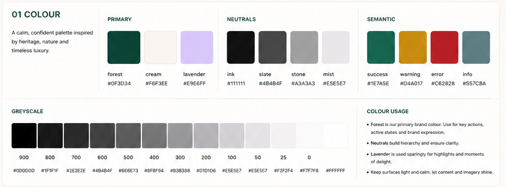

---

## 02 Typography

Ours uses **Instrument Serif + Inter**.

-   **Instrument Serif Regular** --- expressive editorial headlines,
    onboarding, feature titles and selected product/editorial names.
-   **Inter** --- body copy, buttons, navigation, prices, forms, labels,
    badges and functional UI.
-   Instrument Serif should be selective. Its impact comes from contrast
    with Inter.
-   Prefer Instrument Serif Regular rather than bold for large
    statements such as "luxury, together".

### iOS type scale

  -----------------------------------------------------------------------------------
  Token             Typeface                   Size Weight        Use
  ----------------- ------------- ----------------- ------------- -------------------
  `displayLarge`    Instrument                 48pt Regular       Hero / onboarding
                    Serif                                         

  `displayMedium`   Instrument                 40pt Regular       Large editorial
                    Serif                                         heading

  `titleLarge`      Instrument                 32pt Regular       Feature heading
                    Serif                                         

  `titleMedium`     Instrument                 24pt Regular       Product/editorial
                    Serif                                         title

  `heading`         Inter                      20pt Semi Bold     Functional headings

  `bodyLarge`       Inter                      17pt Regular       Prominent body

  `body`            Inter                      16pt Regular       Default body

  `bodySmall`       Inter                      14pt Regular       Supporting copy

  `button`          Inter                      16pt Semi Bold     Actions

  `label`           Inter                      13pt Medium        Labels / metadata

  `caption`         Inter                      12pt Regular       Captions
  -----------------------------------------------------------------------------------

All functional typography must support **Dynamic Type**.

------------------------------------------------------------------------

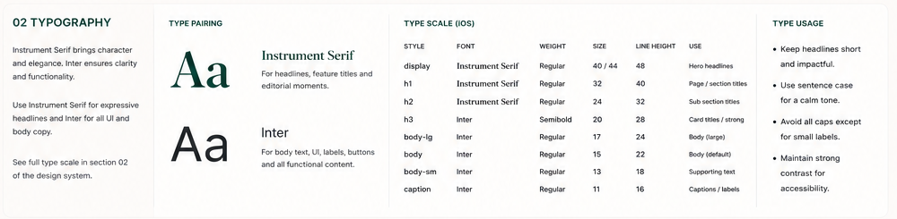

---

## 03 Spacing & Layout

Use a **4pt base grid**, with **8pt increments as the default rhythm**.

  Token          Value Typical use
  ------------ ------- -------------------------------
  `space2xs`       4pt Tiny gaps / icon spacing
  `spaceXs`        8pt Closely related elements
  `spaceSm`       12pt Tight grouping
  `spaceMd`       16pt Standard component padding
  `spaceLg`       24pt Content groups / card padding
  `spaceXl`       32pt Section spacing
  `space2xl`      48pt Large section separation
  `space3xl`      64pt Hero / editorial spacing

**8, 16, 24 and 32pt should cover most of the UI.**

-   Default screen margin: **24pt**
-   Dense utility screens: **16pt**
-   Heading → content: **16pt**
-   Section → next section: **32pt**
-   Major editorial separation: **48--64pt**
-   Standard CTA height: **56pt**

Use spacing tokens rather than arbitrary values. More whitespace is
intentional and contributes to the premium feel.

------------------------------------------------------------------------

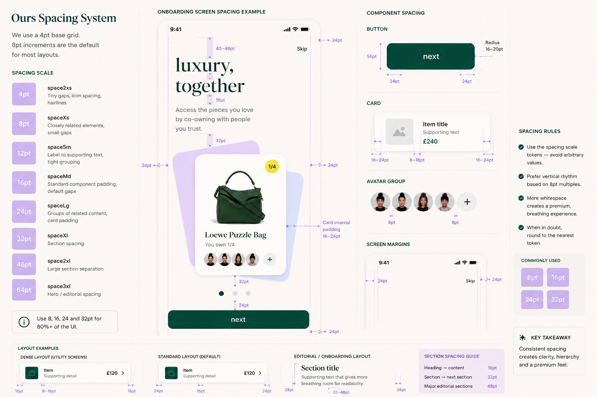

---

## 04 Shape / Corner Radius

  Token          Value Typical use
  ------------ ------- --------------------------------
  `radiusXs`       8pt Small elements, inputs, chips
  `radiusSm`      12pt Buttons, small cards, alerts
  `radiusMd`      16pt Standard cards, inputs, sheets
  `radiusLg`      20pt Large cards and modals
  `radiusXl`      28pt Hero and onboarding cards

Use `radiusMd` for most surfaces. Larger radii are reserved for
expressive or elevated moments.

------------------------------------------------------------------------

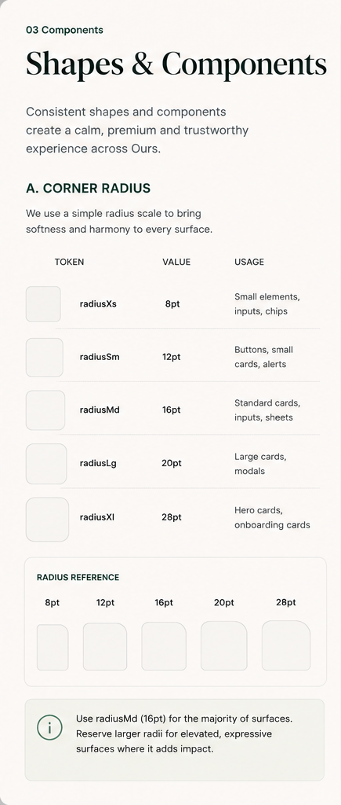

---

## 05 Buttons

### Primary

-   Height: **56pt**
-   Radius: **16pt**
-   Horizontal padding: **24pt**
-   Background: `brandPrimary`
-   Label: Inter Semi Bold, 16pt
-   Main action on a screen

### Secondary

-   Height: **56pt**
-   Radius: **16pt**
-   Horizontal padding: **24pt**
-   Light/transparent surface with primary-colour outline and label

### Tertiary / Text

-   No prominent filled container
-   Optional actions, links and lower-emphasis navigation

### Destructive

-   Use semantic `error`
-   Reserved for irreversible/removing actions

All button types must define **default, pressed, disabled and loading**
states. Minimum interactive target: **44×44pt**. Avoid multiple primary
buttons in the same decision group.

------------------------------------------------------------------------

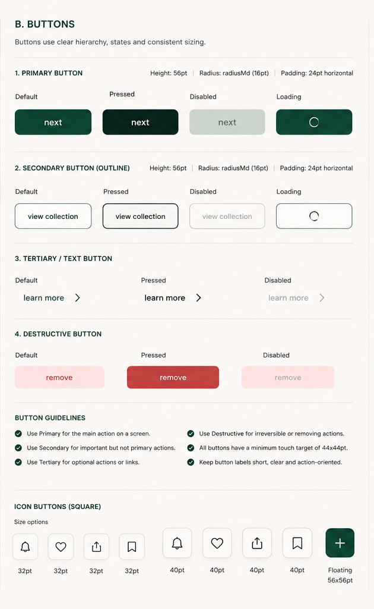

---

## 06 Cards & Surfaces

Standard cards use `radiusMd` (**16pt**) by default.

### Product card

Product image, name, ownership/availability, price, favourite action and
optional co-owner context. Product photography remains the focus.

### Collection card

Collection imagery, name, item count, member/co-owner context and
navigation affordance.

### Ownership card

Ownership fraction/status, relevant payment or scheduling information
and navigation. Supporting brand colours may distinguish ownership
information.

### Information card

Shipping, authentication, care and service information. Keep these
visually quiet.

Prefer clean surfaces over heavy borders. Use **16--24pt** internal
padding. Avoid stacking card layers when spacing alone creates
hierarchy.

------------------------------------------------------------------------

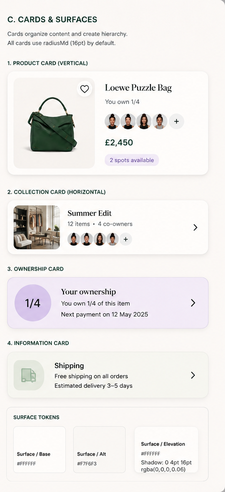

---

## 07 Elevation & Shadows

Ours is mostly flat. Elevation exists only to clarify hierarchy.

  -----------------------------------------------------------------------
  Token                               Use
  ----------------------------------- -----------------------------------
  `elevationNone`                     Backgrounds, sections and most
                                      surfaces

  `elevationSm`                       Product cards, inputs and small
                                      controls needing separation

  `elevationMd`                       Sheets, modals, dropdowns and
                                      important floating elements
  -----------------------------------------------------------------------

Rules: - Use the lowest elevation that achieves clarity. - Shadows
should be soft, low-opacity and restrained. - Prefer `elevationSm` for
cards. - Reserve `elevationMd` for overlays/floating UI. - Avoid
stacking multiple elevated elements. - Do not use shadow as the primary
visual style.

------------------------------------------------------------------------

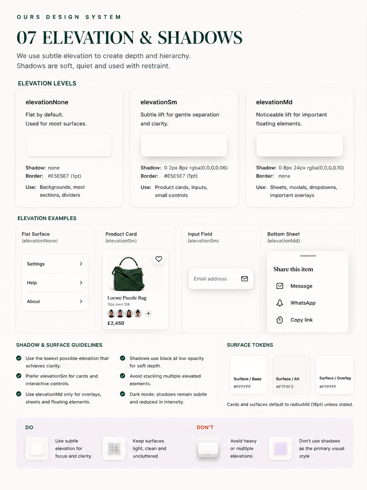

---

## 08 Iconography

Use **SF Symbols** as the primary functional icon set on iOS.

     Size Use
  ------- -------------------------------------------------------------
     16pt Very small supporting indicators
     20pt Small inline icons
     24pt Default UI icon
     32pt Feature/prominent icon
    44pt+ Interactive touch target, not necessarily visual glyph size

-   Prefer outlined symbols by default.
-   Filled variants can communicate selected/active state.
-   Use brand green for active states and `textPrimary` for normal
    functional icons.
-   Icons support meaning; they should not become decoration.
-   Maintain a minimum **44×44pt** interactive hit area.

------------------------------------------------------------------------

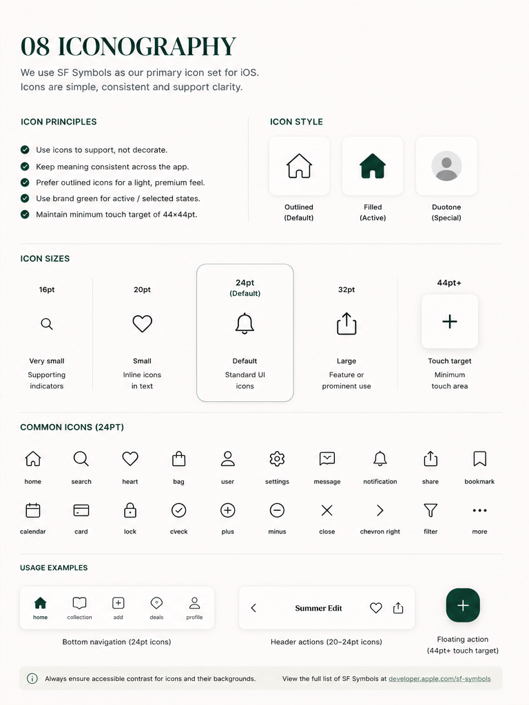

---

## 09 Imagery & Product Photography

### Photography types

**Product photography** is clean, studio-like and accurate. Use for
product pages, cards, search and listings.

**Lifestyle photography** is editorial and aspirational. Use for
collections, discovery, campaigns and storytelling.

### Aspect ratios

-   `1:1` --- default product imagery
-   `4:5` --- editorial / collection imagery
-   `16:9` --- hero / banner
-   `9:16` --- immersive stories / full-screen content

### Cropping & positioning

-   Keep products centred with balanced breathing room.
-   Aim for the product to occupy roughly **60--70%** of the frame where
    appropriate.
-   Avoid tight crops and cutting off important edges.

### Backgrounds

White/cream are the default. Light stone is acceptable.
Lavender/periwinkle are occasional branded campaign surfaces, not the
default product backdrop.

### Overlays

Favourite actions, semantic badges, short labels and carefully treated
text overlays are allowed. Avoid clutter.

### Galleries

Use a clear hero image plus consistent alternate angles/details. Keep
lighting and background consistent.

### User uploads

Support common image formats, provide crop guidance, validate
quality/orientation and optimise file size.

------------------------------------------------------------------------

## 10 Navigation

Use familiar iOS navigation patterns with Ours styling.

### App shell

-   Bottom tab bar for primary navigation
-   Navigation bar for in-flow hierarchy
-   Sheets for additional/contextual options
-   Full-screen presentation for immersive or multi-step flows
-   Modals for focused tasks/decisions

### Bottom tab bar

-   Maximum **5 tabs**
-   Active state uses brand green
-   Minimum **44×44pt** touch target
-   Hide during full-screen flows when appropriate

### Navigation bar

-   Clear, concise title
-   Back for hierarchy
-   Close for modal/full-screen dismissal
-   Contextual actions on the trailing side

### Sheets

Use the smallest useful presentation. Avoid deeply nested sheets.

### Full-screen flows

Use for immersive or multi-step tasks. Keep the user focused, show
progress when useful and provide a clear exit.

Navigation should feel invisible: users should understand where they are
and how to get back without thinking about the navigation system itself.

------------------------------------------------------------------------

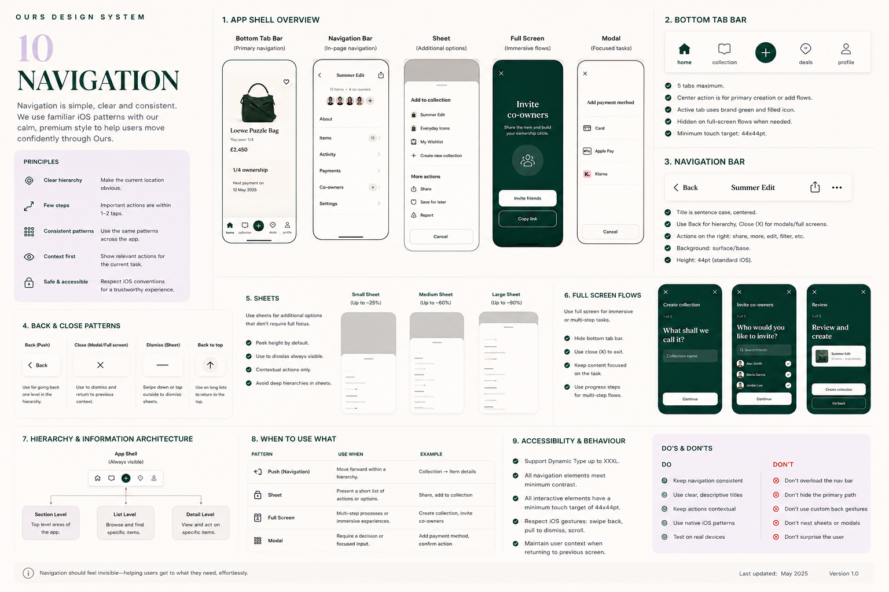

---

## 11 Forms & Inputs

Forms are minimal, predictable and easy to complete.

### Text fields

Define default, focused, filled, disabled, error and success states.
Labels and helper text must remain clear.

### Search

Use a familiar search field with optional clear action. Search is
appropriate for global search and filtering.

### Selection

Support native-feeling: - Radio buttons - Checkboxes - Single-select
chips - Multi-select chips - Segmented controls - Toggles/switches

### Validation

Prefer inline validation close to the affected field. Explain what is
wrong and how to fix it. Do not rely on colour alone.

### Text areas / uploads

Show character limits when relevant. File upload should communicate
supported formats/limits and uploaded state.

### Form layout

-   Single column on mobile
-   Group related fields
-   Clear labels
-   Helpful placeholder/helper text
-   Primary action at the end
-   Keep forms scannable and focused

------------------------------------------------------------------------

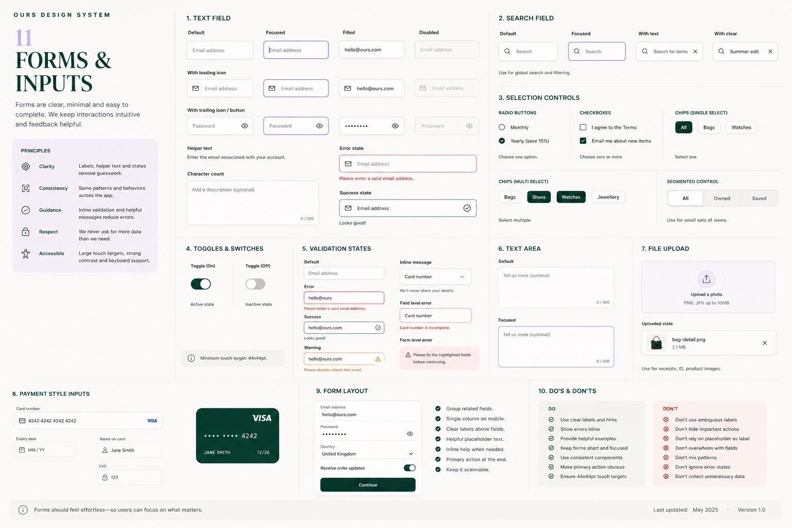

---

## 12 Motion & Animation

Motion should feel **subtle, calm and premium**, never busy.

### Durations

  ------------------------------------------------------------------------
  Token                                     Duration Use
  --------------------- ---------------------------- ---------------------
  `motionQuick`                              \~150ms Press feedback and
                                                     tiny state changes

  `motionStandard`                           \~250ms Standard UI
                                                     transitions

  `motionExpressive`                         \~400ms Larger editorial or
                                                     milestone transitions
  ------------------------------------------------------------------------

### Principles

-   Use natural ease-in/ease-out curves.
-   Button feedback should be immediate and subtle.
-   Card interactions may use restrained scale/fade.
-   Navigation follows familiar iOS transitions.
-   Sheets/modals should feel native.
-   Favourite/save can use a small confirmation animation.
-   Image changes should favour gentle crossfades.
-   Significant success moments may be more expressive, but remain
    controlled.
-   Avoid gratuitous bounce, looping decorative motion and animation
    that delays task completion.
-   Respect **Reduce Motion** by simplifying or removing non-essential
    movement.

------------------------------------------------------------------------

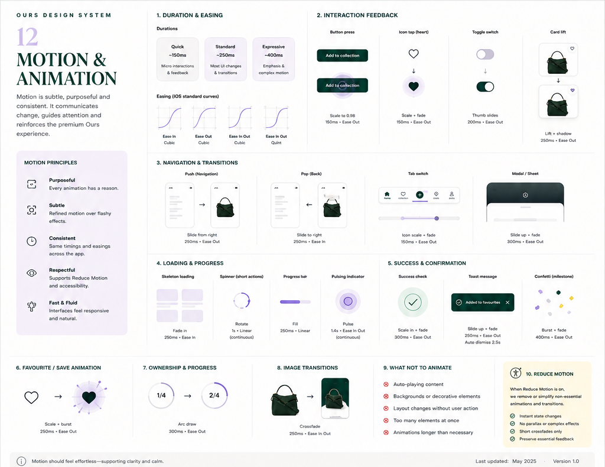

---

## 13 Accessibility

Accessibility is part of every component definition.

-   Support **Dynamic Type**, including accessibility sizes.
-   Minimum interactive target: **44×44pt**.
-   Meet **WCAG AA** contrast requirements.
-   Never communicate state through colour alone.
-   Provide meaningful VoiceOver labels, values and hints.
-   Keep VoiceOver reading order logical.
-   Product imagery gets useful descriptions; decorative imagery is
    excluded.
-   Use descriptive button labels, e.g. "Add Loewe Puzzle Bag to
    favourites" rather than "heart".
-   Form labels/errors must be announced correctly.
-   Avoid fixed-height text containers that clip when type grows.
-   Respect **Reduce Motion**, **Reduce Transparency**, **Bold Text**
    and **Increase Contrast**.
-   Move accessibility focus appropriately after sheets, errors and
    multi-step transitions.
-   Haptics are supplementary feedback, never the only feedback.

> **Luxury should never come at the expense of accessibility.**

------------------------------------------------------------------------

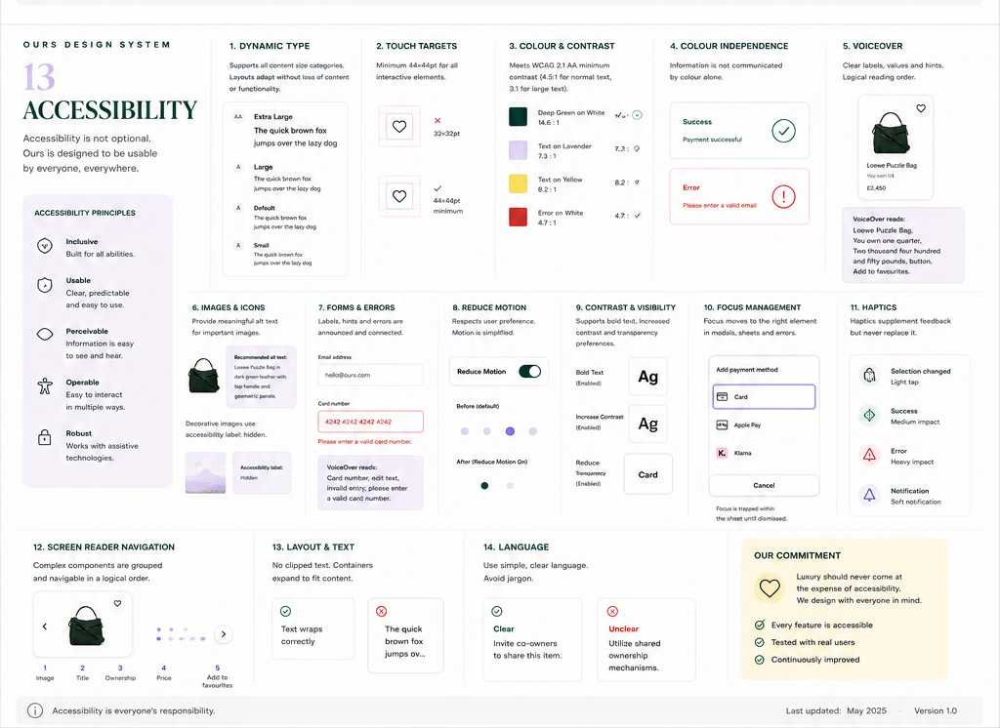

---

## 14 States & Feedback

Use the **least disruptive feedback mechanism that communicates the
result clearly**.

### Feedback hierarchy

1.  UI change
2.  Inline message
3.  Toast / banner
4.  Dialog
5.  Full screen

### Loading

Use skeletons for structured content such as product grids/cards. Use a
spinner for short, isolated actions. Avoid blocking the entire screen
unnecessarily.

### Empty

Use a short editorial heading, concise explanation and one clear action
where useful.

### Error

Explain what happened and what the user can do next. Prefer contextual
errors over generic full-screen errors. Pair colour with icon/text.

### Offline

Keep cached/previous content visible where possible, indicate that it
may be stale and provide retry when an action requires connectivity.

### Success

Prefer subtle UI updates, confirmation messages, checkmarks or haptics.
Reserve full-screen success for meaningful milestones such as completing
a purchase or becoming a co-owner.

### Confirmation

Do not confirm routine/reversible actions. Use dialogs for destructive,
expensive or difficult-to-reverse decisions.

### Destructive

Clearly describe the consequence. Use specific action labels such as
**Remove item** or **Leave collection**, not Yes/No.

### Progress

For multi-step flows, communicate progress such as **2 of 4** or a
subtle progress indicator.

### Notifications / banners

Use for timely, non-blocking information. Important information should
not disappear before it can be understood.

### Badges

Keep badges short and semantic: **New**, **Verified**, **Sold**, **1/4
available**. Yellow can support attention-oriented badges; semantic
states use semantic colours.

------------------------------------------------------------------------

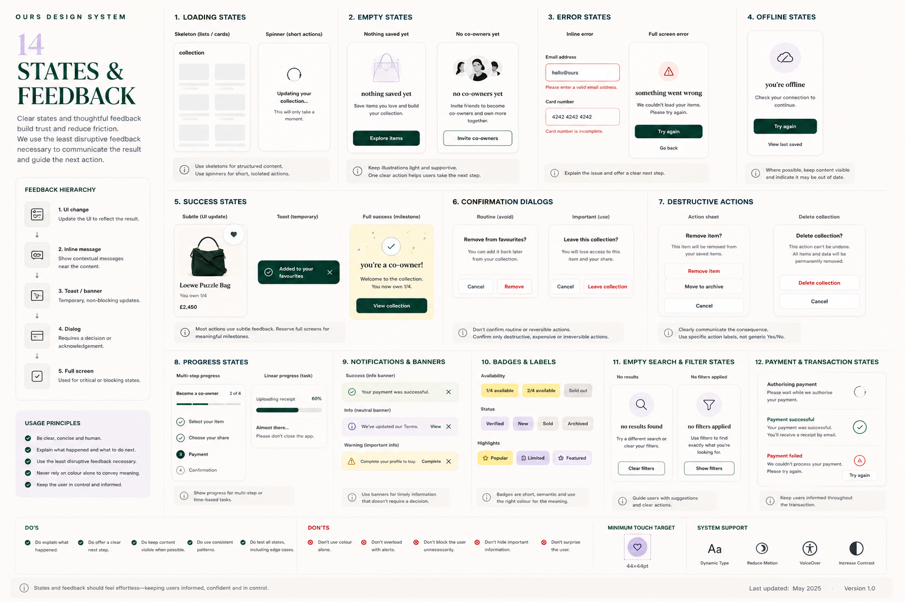

---

## Design System Principles

Across all 14 sections:

-   Keep the interface calm, spacious and product-led.
-   Use brand colour intentionally.
-   Prefer native iOS behaviour when custom behaviour adds no meaningful
    value.
-   Maintain consistent tokens rather than introducing one-off values.
-   Use the least visual weight necessary to establish hierarchy.
-   Keep premium aesthetics compatible with accessibility.
-   Treat this system as a living foundation: extend it only when
    repeated product needs justify a new token, component or pattern.
