# Ours Design System

> A calm, premium design language for co-owning luxury items.

**Status:** reconciled 2026-08-10. The 14 image plates in `assets/` are the source of truth;
this document has been rewritten to match them. Where the plates were silent, incomplete or
demonstrably wrong, the resolution is recorded inline under **Reconciliation**.

**Naming:** *Ours* is the design system's name. *Coterie* is the engineering codename used
throughout the repositories (`coterie-ios`, `coterie-backend`, `coterie-docs`, bundle ID
`com.coterie.app`). The final product name is undecided. Nothing in this document depends on
which is chosen.

**Revised 2026-11-07:** a review of this document against the `OursDesignSystem` package
(`coterie-design` PR #3) settled each difference on UI/UX grounds rather than by which side
was older. Each change is recorded inline under **Revised 2026-11-07**.

**Provenance:** the plates are stamped *Version 1.0, May 2025*. The previous markdown
(`ours-design-system-v2-ORIGINAL.md`, retained for reference) was a later expansion whose
colour and type values diverged from the plates. On a direct conflict, **the plates win**.

---

## Contents

1. Colour · 2. Typography · 3. Spacing & Layout · 4. Shape / Corner Radius · 5. Buttons ·
6. Cards & Surfaces · 7. Elevation & Shadows · 8. Iconography · 9. Imagery ·
10. Navigation · 11. Forms & Inputs · 12. Motion · 13. Accessibility · 14. States & Feedback

---

## 01 Colour

A calm, confident palette inspired by heritage, nature and timeless luxury.

### Brand

| Token | Hex | Role |
|---|---|---|
| `forest` | `#0F3D34` | Primary brand colour. Key actions, active states, brand expression |
| `cream` | `#F6F3EE` | App background and soft warm surfaces |
| `lavender` | `#E9E6FF` | Highlights, feature surfaces and moments of delight. Used sparingly |
| `yellow` | `#F2E074` | Attention badges and small accents |
| `lavenderDeep` | `#E4D6F7` | Decorative surfaces that must read as purple against `cream` |
| `periwinkle` | `#C9D3F3` | Secondary feature surface, paired with `lavenderDeep` in layered compositions |

### Neutrals

| Token | Hex | Use |
|---|---|---|
| `ink` | `#111111` | Primary text |
| `slate` | `#4B4B4F` | Secondary text |
| `stone` | `#6E6E6E` | Tertiary text, metadata, placeholders |
| `mist` | `#E5E5E7` | Decorative borders and dividers — never the edge of a control |
| `outline` | `#86868A` | Resting border of an interactive control |
| `focus` | `#8F64C3` | Border of a focused input, and the text caret |

### Surfaces

| Token | Hex | Use |
|---|---|---|
| `surfaceBase` | `#FFFFFF` | Cards, sheets, navigation bar |
| `surfaceAlt` | `#F6F3EE` | Grouped and secondary backgrounds (same value as `cream`) |
| `backgroundPrimary` | `#F6F3EE` | Main app background |

### Semantic

| Token | Hex | Use |
|---|---|---|
| `success` | `#1E7A5E` | Success and confirmation |
| `warning` | `#8A6410` | Warning and caution |
| `error` | `#C62828` | Errors and destructive actions |
| `info` | `#4A6C78` | Neutral informational messages |

### Usage

- **Forest is the primary brand colour** — key actions, active states, brand expression.
- **Neutrals build hierarchy and ensure clarity.** Keep surfaces light and calm; let content
  and imagery shine.
- **Lavender is used sparingly**, for highlights and moments of delight.
- **Yellow is for attention badges only** — availability counts, "Popular", "Limited".
- **Do not use forest as the semantic success colour.** They are different jobs.
- **`outline` marks a control, `mist` decorates.** A white control on cream is 1.11:1, so its
  border is the only thing that shows it is there. Fields, text areas, unselected chips and
  other white controls take `outline`; card hairlines, dividers and tracks take `mist`.
- **Each lilac has one job.** `lavender` is a backdrop that carries content (the ownership
  card, the feature badge). `lavenderDeep` is a lilac seen as a shape on cream (the onboarding
  card stack). `periwinkle` is only ever layered with `lavenderDeep`. They sit 1.08–1.24:1 from
  one another, so they differ by hue alone: **no lilac marks a state**, and no set of tones
  uses two.

### Contrast

Every pairing below is computed, not estimated. Body text requires **4.5:1**, large text and
UI components **3:1**.

| Pairing | Ratio |
|---|---|
| `ink` on `cream` / `surfaceBase` | 17.06 / 18.88 |
| `slate` on `cream` / `surfaceBase` | 7.85 / 8.68 |
| `stone` on `cream` / `surfaceBase` | 4.61 / 5.10 |
| `forest` on `cream` / `surfaceBase` | 10.92 / 12.09 |
| `white` on `forest` | 12.09 |
| `ink` on `lavender` / `yellow` | 15.49 / 14.11 |
| `forest` on `lavender` / `yellow` | 9.92 / 9.03 |
| `success` / `warning` / `error` / `info` on `cream` | 4.74 / 4.85 / 5.08 / 5.12 |
| `outline` on `surfaceBase` / `cream` (UI, 3:1) | 3.63 / 3.28 |
| `focus` on `surfaceBase` / `cream` (UI, 3:1) | 4.39 / 3.97 |
| `stone` on `disabled` (disabled label, exempt) | 4.05 |

**Lavender, `lavenderDeep`, periwinkle and yellow are fill colours only.** Yellow measures **1.34:1** against white — it
can never be text, an icon, or a thin line. Always place `ink` or `forest` on top of them.

> **Reconciliation.** Three plate tokens failed the WCAG AA commitment made in plate 13 and
> have been darkened along their own hue to the minimum passing value against `cream`:
> `stone` `#A3A3A3` → **`#6E6E6E`** (was 2.28:1 on cream), `warning` `#D4A017` → **`#8A6410`**
> (was 2.38:1 on white), `info` `#557C8A` → `#507582` (was 4.09:1 on cream).
>
> **Revised 2026-11-07 — `info`** darkened again along its hue, `#507582` → **`#4A6C78`**:
> 4.51:1 on cream was the bare minimum, and `info` now carries text and a banner edge on both
> grounds. 5.12:1 on cream, 5.66:1 on white. Closes open question 2.
>
> **Revised 2026-11-07 — `outline`.** §11 drew a resting field's border in `mist`, 1.26:1 on
> white and 1.14:1 on cream — the same "a border that cannot be seen" problem `focus` was
> added to fix, at rest instead of in focus. `outline` (`#86868A`, cool like `mist` and
> `slate`) clears 3:1 on both grounds. It falls between two steps of the reference ramp
> (`#6E6E73`, `#8F8F94`); the lighter step fails on cream at 2.91:1.
>
> **Yellow** is used in plates 03 and 14 but never named or given a hex; `#F2E074` was
> supplied directly. **Periwinkle** was dropped during reconciliation because no plate named
> it, then **reinstated 2026-08-11** at `#C9D3F3` — the approved onboarding design pairs it
> with `lavenderDeep` in the layered card stack. Fill only, and never used to distinguish a
> state from another lilac: it measures 1.22:1 against `lavender` and 1.08:1 against
> `lavenderDeep`. *(Corrected 2026-11-07: this note previously said it pairs with `lavender`
> and measures 1.02:1 against it.)*
>
> **Do not sample colours from the plate images.** They are downscaled screenshots and every
> labelled swatch disagrees with its own pixels: forest `#0F3D34` samples as `#0B4335`, error
> `#C62828` as `#B61E25`, lavender `#E9E6FF` as `#D8C7FA`. The labels are the design intent.
>
> **Greyscale ramp.** Plate 01 carries a 900→0 ramp
> (`#0D0D0D`, `#1F1F1F`, `#2E2E2E`, `#4B4B4F`, `#6E6E73`, `#8F8F94`, `#B3B3B8`, `#D1D1D6`,
> `#E5E5E7`, ?, `#F2F2F4`, `#F7F7F8`, `#FFFFFF`). The `50` step could not be read reliably and
> is omitted. The named neutrals above are what the UI should use; the ramp is reference only.

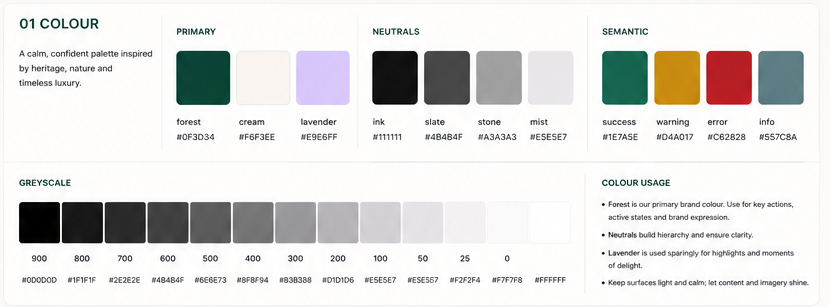

---

## 02 Typography

**DM Serif Display + Inter.** The serif brings character and elegance; Inter ensures clarity
and functionality. Both are open-source, so there is no licensing cost.

The serif is for headlines, feature titles and editorial moments. Inter is for body text, UI,
labels, buttons and all functional content. **The impact of the serif comes from its contrast
with Inter — use it selectively.**

### Type scale (iOS)

| Style | Font | Weight | Size | Line height | Use |
|---|---|---|---|---|---|
| `display` | DM Serif Display | Regular | 40 | 48 | Hero headlines |
| `h1` | DM Serif Display | Regular | 32 | 40 | Page and section titles |
| `h2` | DM Serif Display | Regular | 24 | 32 | Sub-section titles |
| `h3` | Inter | Semibold | 20 | 28 | Card titles, strong labels |
| `body-lg` | Inter | Regular | 17 | 24 | Body (large) |
| `body-lg-strong` | Inter | **Bold** | 17 | 24 | Strong label at body size |
| `body` | Inter | Regular | 15 | 22 | Body (default) |
| `body-sm` | Inter | Regular | 13 | 18 | Supporting text, labels |
| `caption` | Inter | Regular | 11 | 16 | Captions, metadata |
| `button` | Inter | Semibold | 16 | — | Button labels |

### Usage

- Keep headlines short and impactful.
- **Use sentence case.** Avoid all caps except for small labels.
- Maintain strong contrast for accessibility.
- All functional typography must support **Dynamic Type**.

> **Superseded 2026-08-11 — display serif changed.** Plate 02 specifies **Instrument Serif**,
> and this document followed it until the onboarding screen was built. Instrument Serif ships
> **Regular and Italic only**, so it cannot be bolded: `.fontWeight(.bold)` is silently a
> no-op, and getting weight from it requires Core Text synthesis, which the system itself
> advises against — *"prefer Instrument Serif Regular rather than bold for large statements
> such as 'luxury, together'"*. At hero sizes it read too light against the approved design.
>
> **DM Serif Display** replaces it. Same two faces, no bold either, but a far heavier Regular
> that delivers the required weight without synthesis. Plate 02 is therefore out of date on
> typeface; its scale, line heights and usage rules still stand.
>
> Package tokens are named `serifRegular`/`serifItalic` rather than after the family, so a
> future change does not ripple through call sites.
>
> **Added 2026-08-11 — `body-lg-strong`.** The scale had exactly one non-button semibold
> style (`h3` at 20pt), so there was no way to make a smaller strong label without dropping to
> Regular or misusing `button`. `body-lg-strong` is Inter **Bold** at body-large size, backed
> by a bundled Inter Bold face. Note `.fontWeight(.bold)` is not an alternative: SwiftUI only
> selects a bold face when the family ships one, and fails silently when it does not.
>
> **Reconciliation.** The plate omits a `button` token, but plate 05 specifies button labels
> as Inter Semibold 16pt — recorded above. Labels use `body-sm` (13pt); no separate token.
> The plate's `display` size reads `40 / 44`; plate 03 shows onboarding headlines at
> **40–48pt**, so treat 40 as the token and 48 as the permitted hero maximum.

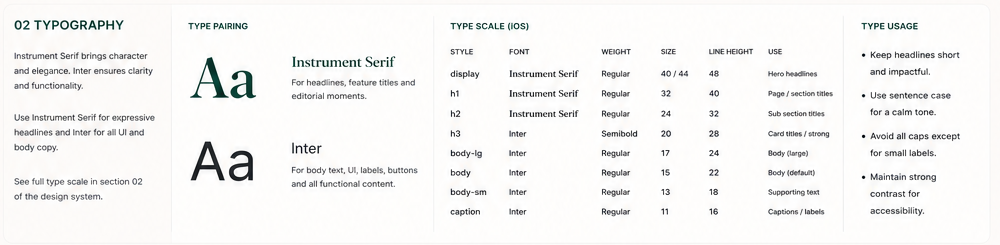

---

## 03 Spacing & Layout

A **4pt base grid**, with **8pt increments as the default rhythm**.

| Token | Value | Use |
|---|---|---|
| `space2xs` | 4pt | Tiny gaps, icon spacing, hairlines |
| `spaceXs` | 8pt | Closely related elements, small gaps |
| `spaceSm` | 12pt | Label to supporting text, tight grouping |
| `spaceMd` | 16pt | Standard component padding, default gaps |
| `spaceLg` | 24pt | Groups of related content, card padding |
| `spaceXl` | 32pt | Section spacing |
| `space2xl` | 48pt | Large section separation |
| `space3xl` | 64pt | Hero and editorial spacing |

**8, 16, 24 and 32pt cover 80%+ of the UI.** When in doubt, round to the nearest token.

### Screen margins

| Layout | Margin |
|---|---|
| Dense / utility | 16pt |
| Standard (default) | 24pt |
| Editorial / onboarding | 24pt, with 32–48pt between sections |

### Vertical rhythm

| From → to | Space |
|---|---|
| Heading → content | 16pt |
| Section → next section | 32pt |
| Major editorial separation | 48pt |

### Component spacing

- **Button** — 56pt height, 24pt horizontal padding, radius 16pt
- **Card** — 16–24pt internal padding
- **Avatar group** — 8pt between avatars, trailing `+` affordance

### Fixed sizes

Specified once as tokens, never as literals in a component. All on the 4pt grid.

| Token | Value | Use |
|---|---|---|
| `buttonHeight` · `fieldHeight` | 56pt | Buttons; single-line fields |
| `minimumTouchTarget` | 44pt | Every interactive element, both dimensions |
| `progressTrack` | 8pt | Funding bar and step segments |
| `overlayButton` | 28pt | Small circular button over content (remove photo), inside a 44pt hit area |
| `avatar` | 32pt | Avatars |
| `iconTile` | 48pt | Icon tile beside text (information card) |
| `figureDisc` | 64pt | Disc holding a short figure (ownership fraction) |
| `statusDisc` | 72pt | Status icon on a full-screen state |
| `thumbnail` | 112pt | Media in a product row |
| `photoTile` | 160pt | Default photo tile |

Stroke widths: **1pt** for resting edges and hairlines, **1.5pt** for dashed outlines (6 on,
4 off) and rings, **2pt** for any border that signals state (focus, error, success, a pressed
secondary button).

### Onboarding screen spec

Taken directly from plate 03 and used by the intro carousel:

| Element | Value |
|---|---|
| Screen margins | 24pt |
| Top → headline | 40–48pt |
| Headline → body | 16pt |
| Body → card | 32pt |
| Card → page dots | 32pt |
| Page dots → primary button | 24pt |
| Button → bottom safe area | 24pt |
| Primary button | 56pt tall, full width |
| `Skip` | top-right, tertiary style |

**Onboarding copy** (plate 03, supersedes the product spec's carousel copy):

> **luxury, together**
> Access the pieces you love by co-owning with people you trust.

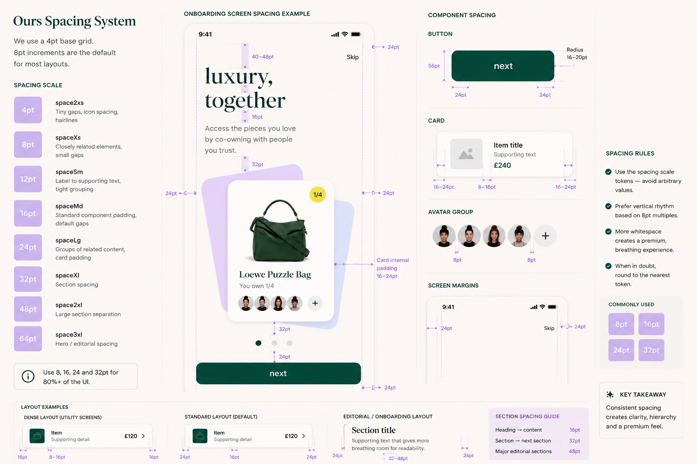

---

## 04 Shape / Corner Radius

| Token | Value | Use |
|---|---|---|
| `radiusXxs` | 4pt | Progress tracks and other thin bars |
| `radiusXs` | 8pt | Small elements: chips, badges, skeletons |
| `radiusSm` | 12pt | Small cards, alerts and message banners, media in cards |
| `radiusMd` | 16pt | Buttons, inputs, standard cards, sheets |
| `radiusLg` | 20pt | Large cards, modals |
| `radiusXl` | 28pt | Hero cards, onboarding cards |

> **Revised 2026-11-07.** The plate listed buttons under `radiusSm` and inputs under both
> `radiusXs` and `radiusMd`; §05 and §11 had already settled both on 16pt, so the table now
> says so. `radiusXxs` is new, for 8pt-tall progress tracks, where 8pt would make a pill.

Use `radiusMd` (16pt) for the majority of surfaces. Reserve larger radii for elevated or
expressive moments where it adds impact.

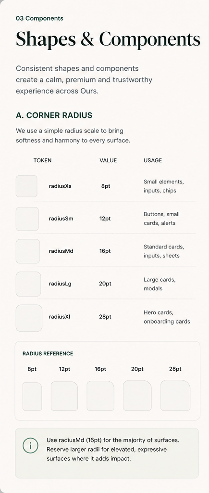

---

## 05 Buttons

All buttons: **56pt height, `radiusMd` (16pt), 24pt horizontal padding, Inter Semibold 16pt**,
minimum touch target **44×44pt**. Every type defines **default, pressed, disabled and loading**.

**Labels are sentence case** — `Next`, `Get started`, `View coterie`, `Remove item`.

> **Superseded 2026-08-11 — button label case.** Plate 05 draws every label lowercase
> (`next`, `view collection`, `learn more`, `remove`), and the app matched that until the
> onboarding screen was reviewed. Sentence case now applies, which also aligns buttons with
> §02's typography rule — *"use sentence case, avoid all caps except for small labels"* —
> that the lowercase plate labels contradicted.

| Type | Default | Pressed | Use |
|---|---|---|---|
| **Primary** | `forest` fill, white label | Darker fill | The main action on a screen |
| **Secondary** | Transparent, `forest` outline and label | Outline thickens | Important but not primary |
| **Tertiary / text** | No container, label; trailing chevron only when it navigates | Label darkens to `ink` | Optional actions and links |
| **Destructive** | Pale red fill, `error` label | Solid `error` fill, white label | Irreversible or removing actions |

Loading state replaces the label with a spinner and keeps the container.
Disabled uses `disabled`/`mist` fill with `stone` label.

**Avoid multiple primary buttons in the same decision group.**

> **Revised 2026-11-07 — tertiary chevron.** The plate draws every tertiary with a chevron,
> but on an action such as `Skip` (§03) it promises a destination that does not exist. The
> chevron is opt-in, for tertiaries that navigate (`View all`).

### Federated sign-in buttons (exception)

Sign in with Apple and Sign in with Google sit **outside the hierarchy above** — none of
primary, secondary, tertiary or destructive describes "sign in with someone else's account" —
but they are still **our** buttons, not the ones each provider publishes.

| Property | Value |
|---|---|
| Fill | `surfaceBase` (white) |
| Border | `outline`, 1pt (*revised 2026-11-07* from `mist`: a white button on cream needs a visible edge, like every other white control) |
| Label | `ink`, `Continue with Apple` / `Continue with Google` |
| Mark | `apple.logo` SF Symbol / Google's official mark, unaltered |
| Geometry | 56pt height, `radiusMd`, `button` text style |

Both providers do publish button specs — Google's light theme wants a `#747775` stroke, Apple
offers black and outlined styles of its own. **We use neither.** A screen where every button
obeys a different house style stops looking like one product, and the provider rule that
actually matters is the one covering the mark: Google forbids substitutes and recolouring, so
theirs is their own asset at its own proportions.

Only the label wording is taken from the providers, since both publish a closed list and
`Continue with …` is on each.

Sign in with Apple may need to move to `AuthenticationServices.SignInWithAppleButton` when it
is wired up, if review asks for it.

### Icon buttons (square)

| Size | Use |
|---|---|
| 32pt | Inline actions — favourite, share, bookmark. Visible size only: the hit area is still 44pt |
| 40pt | Prominent actions |
| 56×56pt | Floating action |

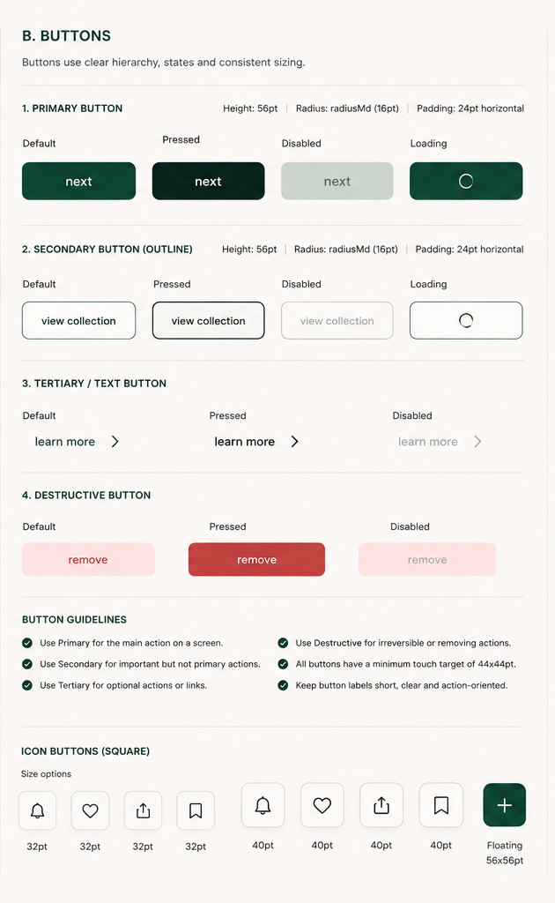

---

## 06 Cards & Surfaces

All cards use `radiusMd` (16pt) unless stated. Internal padding 16–24pt. Prefer clean
surfaces over heavy borders, and don't stack card layers when spacing alone creates hierarchy.

| Card | Contents |
|---|---|
| **Product (vertical)** | Grids and discovery. Image, title (serif), ownership line, avatar group, price in `forest`, availability pill, favourite action. *Not built yet* |
| **Product row (horizontal)** | Lists. 112pt media left, serif title, subtitle, price in `forest`, footer slot. Built as `OursProductCard` |
| **Collection (horizontal)** | Image, name, item count and co-owner count, avatar group, chevron |
| **Ownership** | `lavender` surface, ownership fraction in a **`forest` disc with a white figure**, status, next payment, chevron |
| **Information** | Quiet neutral surface, icon, title, supporting detail, chevron |

Ownership cards are the one place brand colour carries a whole surface. Information cards stay
visually quiet.

> **Revised 2026-11-07 — ownership disc.** The disc was `lavenderDeep` on the `lavender` card,
> 1.13:1, so its edge barely showed and the fraction floated. A `forest` disc (12.09:1 for the
> white figure) makes ownership — what the card is about — the first thing read. Card layouts
> are named by layout (vertical, row), not by content, so one shape can serve several kinds.

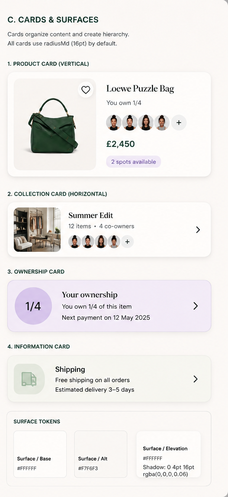

---

## 07 Elevation & Shadows

Mostly flat. Elevation exists only to clarify hierarchy.

| Token | Shadow | Border | Use |
|---|---|---|---|
| `elevationNone` | none | `mist` 1pt | Backgrounds, sections, dividers |
| `elevationSm` | `0 2px 8px rgba(0,0,0,0.06)` | `mist` 1pt | Product cards, small raised controls |
| `elevationMd` | `0 8px 24px rgba(0,0,0,0.10)` | none | Sheets, modals, dropdowns, overlays |

- Use the lowest elevation that achieves clarity.
- Prefer `elevationSm` for cards and interactive controls.
- Reserve `elevationMd` for overlays, sheets and floating elements.
- Avoid stacking multiple elevated elements.
- **Never use shadow as the primary visual style.**
- In dark mode, shadows remain subtle and reduce in intensity.

> **Revised 2026-11-07.** Inputs no longer take `elevationSm`. A shadowed text field is not an
> iOS convention, and the `outline` border (§11) already marks the field.
>
> **Reconciliation.** Plate 06 lists the card shadow as `0 4pt 16pt rgba(0,0,0,0.06)`, which
> conflicts with plate 07's `elevationSm`. Plate 07 wins.

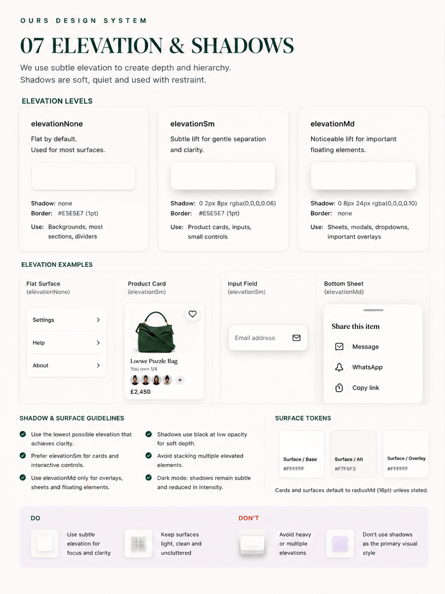

---

## 08 Iconography

**SF Symbols** is the primary icon set on iOS.

| Style | Use |
|---|---|
| Outlined | Default |
| Filled | Selected / active state |
| Duotone | Special cases only |

| Size | Use |
|---|---|
| 16pt | Very small supporting indicators |
| 20pt | Small inline icons in text |
| 24pt | **Default** standard UI icon |
| 32pt | Feature or prominent use |
| 44pt+ | Minimum interactive touch area, not glyph size |

Use `forest` for active and selected states, `ink` for icons you act on, and `slate` for
supporting icons — chevrons, an information card's icon, avatar placeholders. Icons support
meaning — they should not become decoration.

A glyph inside a small control (the 12pt `xmark` in a 28pt remove button) sits below this scale
on purpose; 16pt would crowd it. *(Revised 2026-11-07: the package had used 14 / 22 / 28 and now
follows 16 / 24 / 32.)*

**Common set (24pt):** home, search, heart, bag, user, settings, message, notification, share,
bookmark, calendar, card, lock, check, plus, minus, close, chevron right, filter, more.

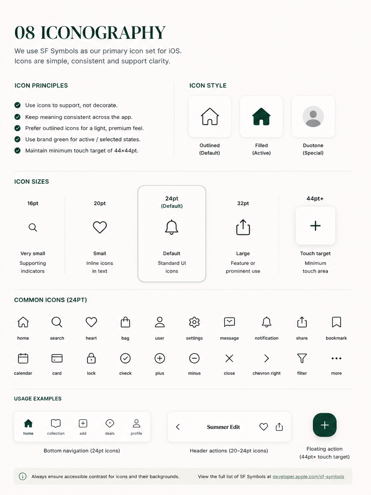

---

## 09 Imagery & Product Photography

Great imagery builds trust and desirability. Photography is clean, consistent, and lets the
product shine.

### Types

- **Product** — clean, studio-style, accurate colour, full focus on the item, minimal props.
  Used on product pages, cards, search and listings.
- **Lifestyle** — editorial and aspirational, warm natural tones, human or environmental
  context, never over-styled. Used for collections, discovery and brand content.

### Aspect ratios

| Ratio | Use |
|---|---|
| `1:1` | Product (default) — grids, cards, gallery thumbnails |
| `4:5` | Editorial — collection cards, feature stories |
| `16:9` | Hero / banner — home hero, promotions |
| `9:16` | Stories / full-screen — onboarding, immersive content |

### Cropping

Keep products centred with balanced breathing room. **The product should occupy roughly
60–70% of the frame.** Avoid tight crops and cutting off important edges.

### Backgrounds

White (default) · cream (soft warm alternative) · light stone (subtle texture acceptable) ·
lavender (campaigns and branded moments only) · lifestyle (editorial only).

Keep backgrounds clean and consistent across similar content. Avoid busy patterns, harsh
shadows and strong colour casts.

### Overlays

Favourite action top-right with a 40×40pt tap target · semantic badges · gradient behind text
overlays for readability · clear, concise price labels. Avoid clutter.

### Galleries

First image is the hero. Include key angles — front, back, side, detail, interior. Keep
lighting and background consistent. Tap thumbnail to switch.

### Quality

Minimum **2000px on the long edge**. True-to-life colour, soft even lighting, no heavy
filters, no distortion, no watermarks or added text.

### User uploads

Allow JPG, PNG and HEIC. Provide crop guidance and aspect options. Validate quality,
orientation and inappropriate content. Optimise file size for performance.

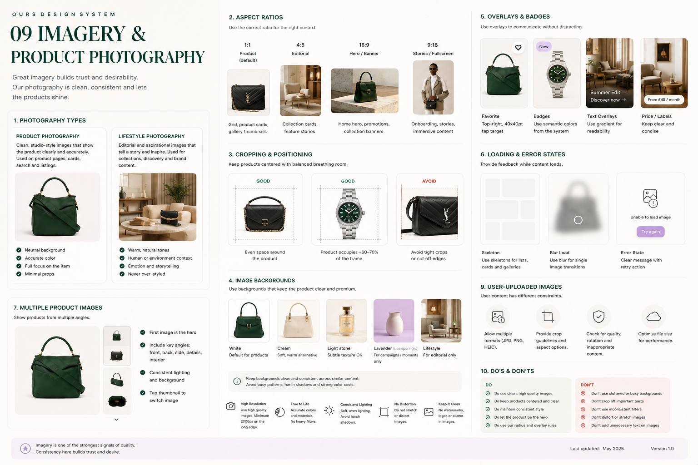

---

## 10 Navigation

Familiar iOS patterns with Ours styling. Navigation should feel invisible.

### App shell

| Pattern | Use |
|---|---|
| **Bottom tab bar** | Primary navigation |
| **Navigation bar** | In-page hierarchy |
| **Sheet** | Additional or contextual options |
| **Full screen** | Immersive or multi-step flows |
| **Modal** | Focused tasks and decisions |

### Vocabulary

The co-ownership group is a **coterie** in everything the user reads. The table is `pools`
and the spec says "pool" throughout — a deliberate internal/external split, recorded here
because three names were in play: the spec's `pool`, the app's `coterie`, and this document's
own `collection` (in "Leave collection", "View collection"). Those examples describe a
coterie. Use **coterie** in UI copy; `pool` stays in the schema and the spec.

### Bottom tab bar

- **5 tabs maximum.** The centre action is for primary creation or add flows.
- Active tab uses `forest` and a filled icon.
- Minimum touch target 44×44pt.
- Hidden during full-screen flows.

> The plate's example tabs (home · collection · **+** · deals · profile) are illustrative
> only. The product's real information architecture is defined by the product spec, not here.

> **Decided 2026-08-13 — the app's tabs.** Discover · Coteries · **+** · Profile. Chat sits
> inside a coterie and booking inside an item, both following the spec's own journeys: a
> thread or a calendar belongs to the thing it is about, and a top-level tab for either would
> be empty until the user joins something. Notifications are a nav-bar bell, settings a row in
> Profile. Note the create action cannot be literally centred with an even number of slots —
> it sits fourth of four minus one, just right of centre. A floating action button (§05, 56pt)
> is the alternative if that ever grates.

### Navigation bar

Title in sentence case, centred. Height 44pt. Background `surfaceBase`. **Back** for
hierarchy, **Close (X)** for modals and full-screen. Contextual actions trailing.

### Sheets

| Size | Height |
|---|---|
| Small | up to ~25% |
| Medium | up to ~60% |
| Large | up to ~90% |

Peek height by default, dismiss always visible, contextual actions only. **Avoid deep
hierarchies and nested sheets.**

### Full-screen flows

Hide the bottom tab bar. Close (X) to exit. Keep content focused. **Show progress steps for
multi-step flows** — "1 of 3".

### Back & close patterns

| Pattern | Use |
|---|---|
| Back (push) | Going back one level in the hierarchy |
| Close (X) | Dismiss modal or full-screen, return to previous context |
| Dismiss (drag handle) | Swipe down or tap outside to dismiss sheets |
| Back to top | Long lists |

### Hierarchy

App shell (always visible) → **Section level** (top-level areas) → **List level** (browse and
find) → **Detail level** (view and act on specific items).

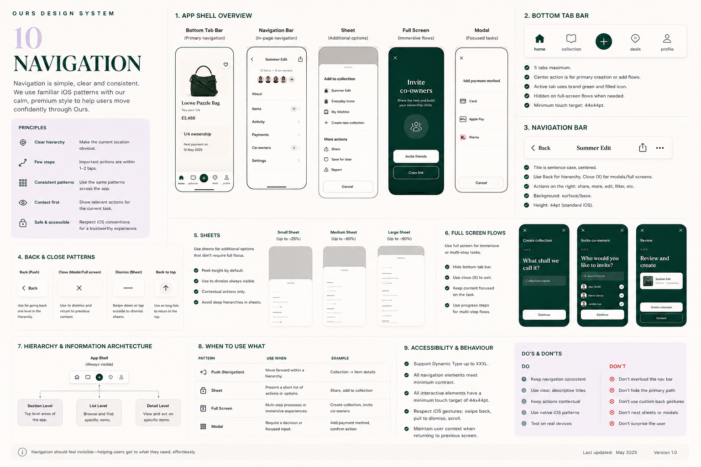

---

## 11 Forms & Inputs

Clear, minimal and easy to complete.

### Text fields

States: **default · focused · filled · disabled · error · success**. Focused uses a lavender
border. Error uses an `error` border with a message beneath. Success shows a check and a short
confirmation. Support leading icons and trailing icon buttons such as password reveal.

Helper text sits below the field. Show a character count where a limit applies.

**56pt height** (matching buttons, so a form and its primary action share one rhythm),
**`radiusMd` (16pt)**, 16pt horizontal padding. Border is **`outline` at 1pt at rest** and 2pt
when focused (`focus`), in error (`error`) or confirmed (`success`). Disabled fields keep a
`mist` border on a `disabled` fill. **Error outranks focus** — a field the user is fixing keeps showing what
is wrong while they type in it.

> **Resolved 2026-08-11 — input radius.** §04 lists inputs under both `radiusXs` (8pt) and
> `radiusMd` (16pt), so the plates had to settle it. Measuring corner radius as a fraction of
> height — which cancels out the plates' different scales — plate 11's fields are 0.13 and
> plate 05's primary button is 0.14. They are drawn the same, so fields take whatever buttons
> take: 16pt.

> **Added 2026-08-11 — `focus`.** "Focused uses a lavender border" had no usable colour behind
> it: `lavender` measures 1.22:1 on white, so a border drawn in it cannot be seen, well short
> of the 3:1 WCAG asks of a control boundary. `focus` (`#8F64C3`) is the same hue taken down
> to 4.39:1. The pale lavenders stay what they are — backing tints, not borders.

### Search

Familiar search field with optional clear action. Used for global search and filtering.

### Selection controls

Radio buttons · checkboxes · single-select chips · multi-select chips · segmented controls ·
toggles. Selected chips use `forest` fill with a white label.

### Validation

- Prefer **inline validation close to the affected field**.
- Explain what is wrong and how to fix it.
- Support field-level and form-level errors.
- **Never rely on colour alone** — pair with icon and text.

### File upload

Dashed `stone` drop zone, 1.5pt, on `surfaceBase`. *(Revised 2026-11-07 from "dashed
lavender": §01 rules out lavender as a thin line, and at 1.22:1 the dash would not show.)* State supported formats and size limit. Show the uploaded file with
name, size and a remove action.

### Layout

Single column on mobile · group related fields · clear labels above fields · helpful
placeholder and helper text · primary action at the end · keep it scannable.

**Don't** use ambiguous labels, hide important actions, rely on placeholders as labels, or
collect unnecessary data.

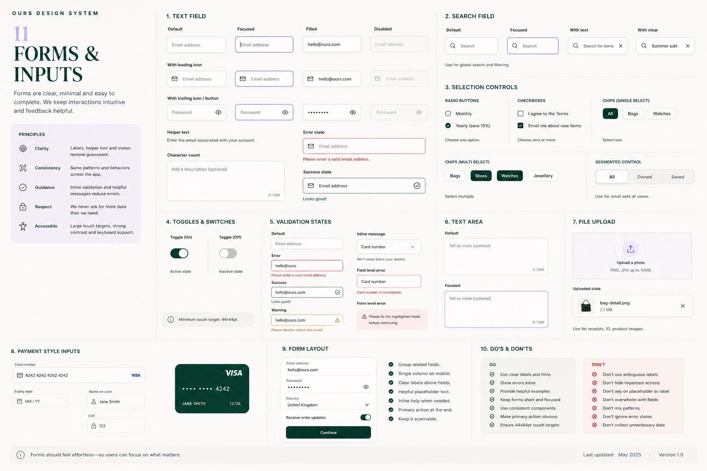

---

## 12 Motion & Animation

Subtle, purposeful and consistent. Motion communicates change, guides attention and reinforces
the premium feel.

| Token | Duration | Use |
|---|---|---|
| `motionQuick` | ~150ms | Micro-interactions and feedback |
| `motionStandard` | ~250ms | Most UI changes and transitions |
| `motionExpressive` | ~400ms | Emphasis and complex motion |

Use standard iOS easing curves — ease in, ease out, ease in-out.

### Specified interactions

| Interaction | Motion |
|---|---|
| Button press | Scale to 0.98 · 150ms · ease out |
| Icon tap (heart) | Scale + fade · 150ms · ease out |
| Toggle switch | Thumb slides · 200ms · ease out |
| Card lift | Lift + shadow · 250ms · ease out |
| Push / pop navigation | Slide · 250ms · ease out / ease in |
| Tab switch | Icon scale + fade · 150ms |
| Modal / sheet | Slide up + fade · 300ms · ease out |
| Skeleton loading | Fade in · 250ms · ease in |
| Progress bar fill | 250ms · linear |
| Success check | Scale in + fade · 300ms · ease out |
| Toast | Slide up + fade · 250ms, auto-dismiss 2.5s |
| Confetti (milestone) | Burst + fade · 400ms · ease out |
| Favourite / save | Scale + burst · 250ms · ease out |
| Ownership progress | Arc draw · 300ms · ease out |
| Image transition | Crossfade · 250ms · ease in-out |
| Feedback delay | Show nothing for the first **400ms** of a wait, then fade in · 250ms |

### Do not animate

Auto-playing content · backgrounds or decorative elements · layout changes without user
action · too many elements at once · anything longer than necessary.

### Reduce Motion

When enabled: instant state changes, no parallax or complex effects, short crossfades only,
and essential feedback preserved.

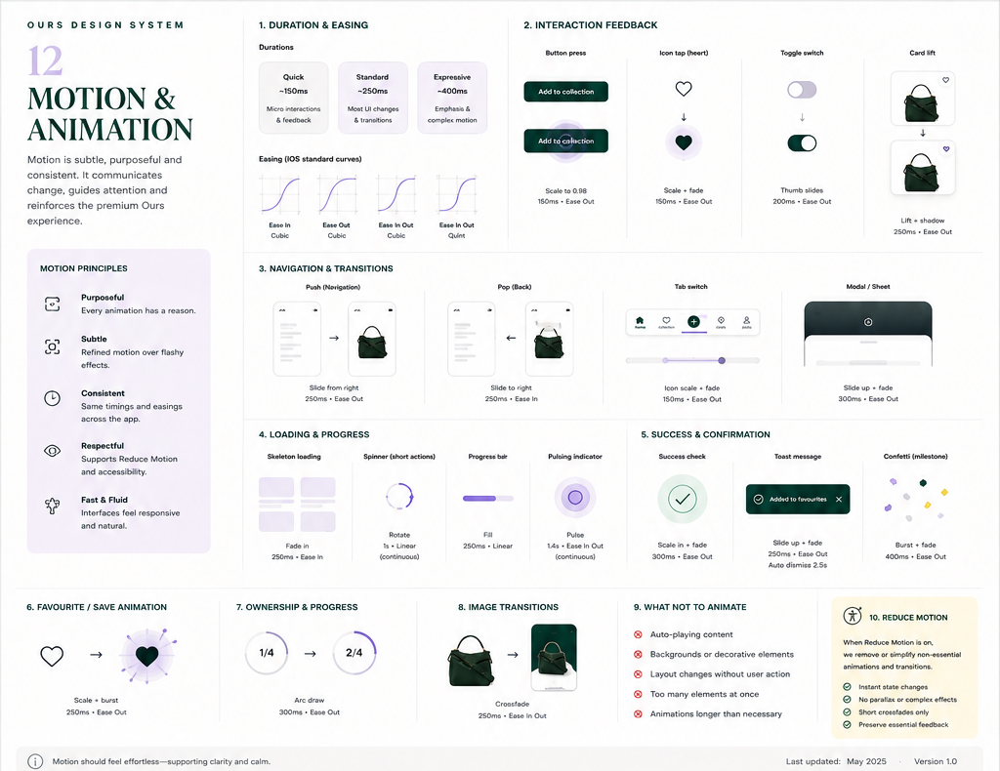

---

## 13 Accessibility

> **Luxury should never come at the expense of accessibility.**

- **Dynamic Type** supported up to XXXL. Layouts adapt without loss of content or
  functionality. No clipped text; containers expand to fit.
- **Touch targets** minimum 44×44pt for all interactive elements.
- **Contrast** meets WCAG 2.1 AA — 4.5:1 normal text, 3:1 large text and UI.
- **Never communicate information by colour alone** — pair with icon, text or shape.
- **VoiceOver** — clear labels, values and hints; logical reading order; complex components
  grouped and navigable in order. Product images get meaningful descriptions; decorative
  images are hidden.
- **Forms** — labels, hints and errors are announced and connected to their field.
- **Focus management** — focus moves to the right element in modals, sheets and errors, and is
  trapped within a presented sheet until dismissed.
- **Respect** Reduce Motion, Increase Contrast, Reduce Transparency and Bold Text.
- **Haptics** supplement feedback and never replace it — light for selection, medium for
  success, heavy for error, soft for notification.
- **Language** — simple and clear. "Invite co-owners to share this item", not "utilise shared
  ownership mechanisms".

> **Reconciliation.** The contrast figures printed on plate 13 are incorrect — none of the four
> matches a computed value (claimed 14.6 / 7.3 / 8.2 / 4.7; actual 12.09 / 15.49 / 14.77 /
> 5.62). The verified table in §01 supersedes them.

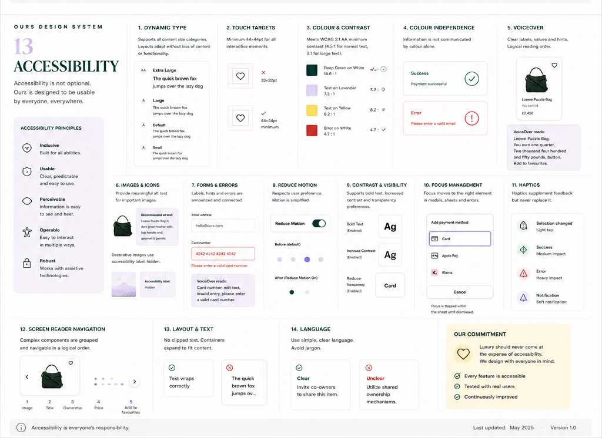

---

## 14 States & Feedback

Use the **least disruptive feedback that communicates the result clearly**.

### Feedback hierarchy

1. UI change · 2. Inline message · 3. Toast / banner · 4. Dialog · 5. Full screen

### Loading

**Skeletons** for structured content — lists, cards, galleries. **Spinners** for short isolated
actions. **Blur load** for single image transitions. Don't block the screen unnecessarily.

### Empty

Short editorial heading, concise explanation, one clear action. Keep illustrations light and
supportive.

### Error

Explain what happened and what to do next. Prefer contextual errors over full-screen. Offer a
retry. Pair colour with icon and text.

### Inline message (banner)

Tone colour for the text and icon, `body-sm`, 12pt padding, `radiusSm`, and a **1pt border in the
tone colour**. Error sits on `errorSurface`, warning on `peach`, info and success on
`surfaceBase`. Every ground is within 1.11:1 of `cream`, so without the border a banner on the app
background reads as loose text. VoiceOver reads the tone as a word first ("Error.").

### Offline

Keep cached content visible, indicate it may be out of date, and provide retry when an action
requires connectivity.

### Success

Prefer subtle UI updates, toasts, checkmarks or haptics. **Reserve full-screen success for
meaningful milestones** such as becoming a co-owner — where a more expressive treatment,
including confetti, is permitted.

### Confirmation

**Do not confirm routine or reversible actions.** Use dialogs only for destructive, expensive
or irreversible decisions.

### Destructive

Clearly state the consequence. Use specific labels — **Remove item**, **Leave coterie** —
never Yes/No. Present as an action sheet where appropriate.

### Progress

Multi-step flows show step progress — "2 of 4". Task progress uses a linear bar with a label.

### Badges

Short and semantic. Availability — `1/4 available`, `2/4 available`, `Sold out`.
Status — `Verified`, `New`, `Sold`, `Archived`. Highlights — `Popular`, `Limited`, `Featured`.
Yellow supports attention-oriented badges; semantic states use semantic colours.

### Payment & transaction

Keep the user informed throughout — authorising, successful, failed with a retry. Payment is
the highest-stakes flow in the product and gets the clearest possible messaging.

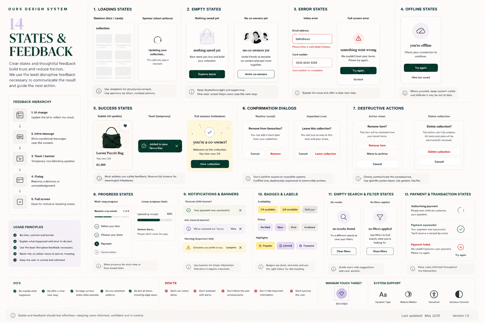

---

## Principles

- Keep the interface **calm, spacious and product-led**.
- Use brand colour **intentionally**, not evenly.
- **Prefer native iOS behaviour** when custom behaviour adds no meaningful value.
- Maintain **consistent tokens** rather than one-off values.
- Use the **least visual weight** necessary to establish hierarchy.
- Keep premium aesthetics **compatible with accessibility**.
- Treat this as a **living foundation** — extend it only when repeated product needs justify a
  new token, component or pattern.

---

## Open questions

1. **Greyscale `50` step** — could not be read reliably from plate 01. Confirm the value or
   confirm the ramp is reference-only and can be dropped.
2. ~~`info` at 4.51:1 on `cream`~~ — **decided 2026-11-07: darkened to `#4A6C78`**, 5.12:1 on
   cream. See §01.
3. ~~Dark mode~~ — **decided 2026-08-11: the app is light-only.** No dark palette will be
   defined for now. The app sets `UIUserInterfaceStyle: Light`, so it renders light even on a
   device in dark mode. Without that lock the tokens would stay light while system chrome —
   text fields, sheets, the keyboard, default label colours — flipped dark, giving a mixed
   result worse than either mode. Plate 07's note about dark-mode shadows is therefore
   dormant, not lost. Revisit before public launch: light-only is increasingly conspicuous.
   The package is ready for it: each token can take a dark value, and the contrast tests
   already run in both appearances.
4. **Onboarding copy** — plate 03's *"luxury, together"* now supersedes the three-slide
   carousel copy in the product spec §6. The product spec needs updating to match, or a
   decision that the plate copy applies only to the first slide.
